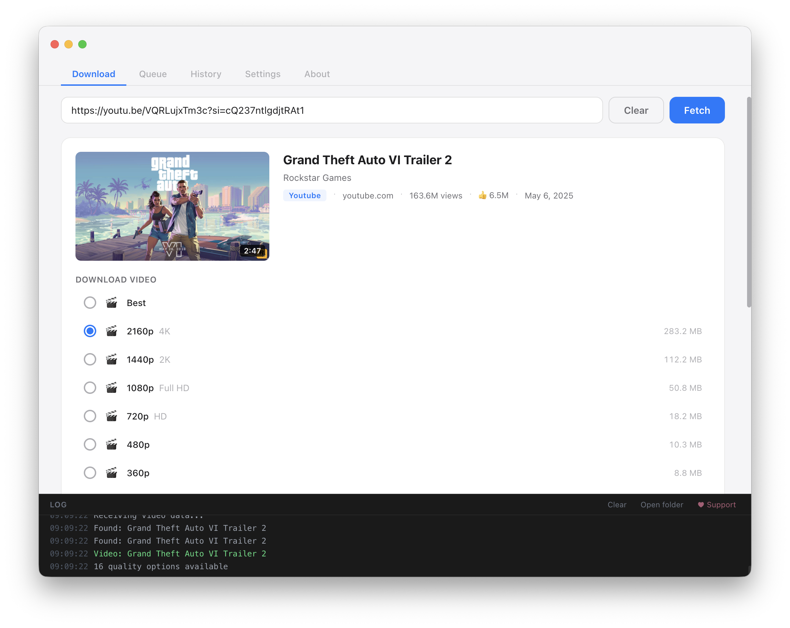
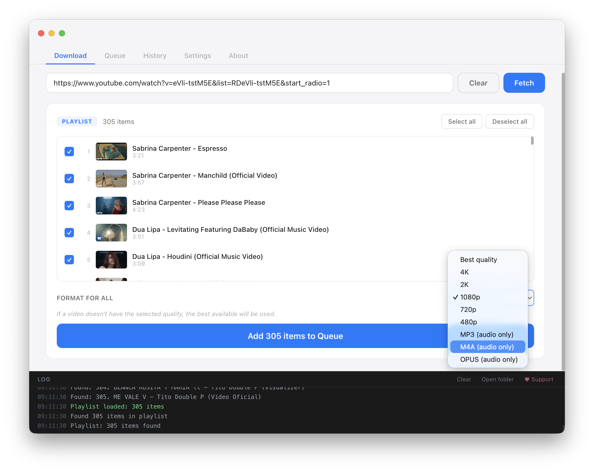

<div align="center">


# ArcDLP

[ArcDLP Website](https://arcdlp.archisvaze.com)

**Free, open source video downloader for Mac, Windows and Linux.**

Open-source desktop video downloader powered by
[yt-dlp](https://github.com/yt-dlp/yt-dlp). Paste a URL, pick a quality,
download. Whole playlists and channels too, or just the audio as MP3.

Supports YouTube, Vimeo, Twitter/X, SoundCloud, Instagram, TikTok, Reddit, and
[thousands of other sites](https://github.com/yt-dlp/yt-dlp/blob/master/supportedsites.md).

Everything runs locally on your machine - no cloud, no accounts, no tracking.
No Python, no Homebrew, no ffmpeg setup: everything is built in.

[](https://github.com/archisvaze/arcdlp/releases/latest)
[](https://github.com/archisvaze/arcdlp/releases)
[](LICENSE)


**[Download](https://github.com/archisvaze/arcdlp/releases/latest)**

</div>

<br/>

<p align="center">
  
  &nbsp;&nbsp;
  
</p>

## Why ArcDLP

[yt-dlp](https://github.com/yt-dlp/yt-dlp) is the best video downloader there
is, but it's a command line tool. Using it normally means installing Python or
Homebrew, installing ffmpeg separately, and learning format codes like
`bv*[height<=1080]+ba/b` just to get 1080p.

ArcDLP puts all of that in one app. yt-dlp, ffmpeg and Deno come bundled and
ready to go, and the format codes become buttons. Install it like any other app,
paste a link, and download.

## Download & Install

**[Download the latest release](https://github.com/archisvaze/arcdlp/releases/latest)**

Go to the Releases page, scroll down to **Assets**, and click the file for your
system:

- **macOS** (Apple Silicon, macOS 13 Ventura or later): `ArcDLP-x.x.x-arm64.dmg`
- **Windows** (Windows 10 or later): `ArcDLP-Setup-x.x.x.exe`
- **Linux** (x64): `ArcDLP-x.x.x.AppImage`

No dependencies to install. yt-dlp, ffmpeg and Deno are bundled inside the app.

### macOS

1. Download the `.dmg` file
2. Open it and drag ArcDLP to your Applications folder
3. Open ArcDLP

macOS will show a security warning the first time because the app is not
notarized by Apple yet (that needs a paid Apple Developer account). This is
normal.

To fix it:

1. Click **Done**
2. Open **System Settings**
3. Go to **Privacy & Security**
4. Scroll down and click **Open Anyway** next to ArcDLP
5. Enter your password

You only need to do this once.

If macOS instead says ArcDLP "is damaged and can't be opened", open Terminal,
run this, then open ArcDLP again:

```bash
xattr -cr /Applications/ArcDLP.app
```

Intel Macs: there's no ready-made Intel build yet. You can
[build from source](#build-from-source) on an Intel Mac.

### Windows

1. Download and run the `.exe` installer
2. If Windows SmartScreen appears, click **More info**, then click **Run anyway**
3. The installer will set up ArcDLP and create a shortcut automatically

ArcDLP installs per-user (no admin required) and can be uninstalled from
Settings > Apps.

### Linux

1. Download the `.AppImage` file
2. Make it executable: right-click → Properties → Permissions → check **Allow
   executing file as program**
3. Double-click to run

No libfuse2 needed. The AppImage also supports delta updates through
AppImageUpdate, AM and AppImageLauncher.

## Features

- **Single video downloads** - Fetch video info, preview metadata, choose
  quality (4K/2K/1080p/720p/480p/360p/240p), and download as MP4 or extract
  audio as MP3, M4A or Opus with title, artist and cover art. Fetch multiple
  URLs back-to-back without waiting - each result appears in a side panel for
  quick review and queueing
- **Multi-video posts** - Instagram carousels, Reddit galleries and X posts with
  several videos open as a list you can pick from
- **Chapters** - Embed chapter markers in the file, or split a video into one
  file per chapter
- **Video codec selection** - Choose Auto, H.264, VP9, or AV1 in Settings.
  Applied as a preference rather than a hard filter, so a video that doesn't
  offer the chosen codec still downloads using the best available one
- **Playlist support** - Paste a playlist URL, select which items to download,
  pick a format, and queue them all at once. YouTube channels (`@name`),
  SoundCloud sets and albums work the same way, and you can stop a long fetch
  and keep what loaded
- **Plays everywhere** - MP4 downloads get AAC audio, so they play in QuickTime,
  Windows Media Player and every video editor
- **Drag and drop** - Drop a link onto the window, or use the Paste button
- **Instagram saved collections** - Paste a saved collection URL, the app scrapes
  all post links from the collection page, and queues them for download
- **Download queue** - Sequential processing with per-item progress (including
  the merging and converting steps), retry, cancel, and remove. Cancelling
  cleans up partial files. One failure never stops the rest
- **YouTube sign-in** - Access age-restricted, private, and members-only content
  through a built-in browser login window. Credentials go directly to Google
- **Instagram sign-in** - Access your private saved collections through a
  built-in browser login window. Credentials go directly to Instagram
- **Download history** - Quick access to previously fetched videos with cached
  metadata
- **Multi-site compatibility** - Works with any site yt-dlp supports. Format
  detection adapts automatically to different streaming approaches across sites
- **Update notifications** - The app checks for new releases on startup and lets
  you know when an update is available
- **Update yt-dlp from Settings** - When a site breaks, update yt-dlp in one
  click without waiting for a new ArcDLP release
- **Proxy support** - HTTP, HTTPS and SOCKS proxies in Settings > Network
- **Light and dark mode** - Follows your system preference. macOS vibrancy
  supported

## Supported Sites

Anything [yt-dlp supports](https://github.com/yt-dlp/yt-dlp/blob/master/supportedsites.md),
including YouTube, Instagram, X (Twitter), TikTok, Reddit, Facebook, Vimeo,
SoundCloud, Twitch, Dailymotion, Bandcamp and the Internet Archive.

ArcDLP can't download DRM-protected streaming services such as Netflix, Disney+
or Prime Video.

## Usage

1. Paste a video or playlist URL and click **Fetch**
2. Pick a quality (or choose MP3, M4A or Opus for audio extraction)
3. Click **Add to Queue**
4. Downloads are saved to `~/Downloads/ArcDLP` by default (changeable in
   Settings)

You can paste and fetch additional URLs while reviewing results. Each fetched
video appears in a side panel - click any item to review it, pick a quality, and
add it to the queue. Adding a video to the queue automatically loads the next
one.

For playlists, you can select/deselect individual items and choose a format for
the whole batch before queueing.

To access private or age-restricted YouTube videos, sign in via **Settings >
YouTube Account**. Your credentials go directly to Google through their standard
login page.

**A site stopped working?** Sites change all the time. Open **Settings >
Dependencies** and click **Update** next to yt-dlp. That fixes most problems.

### Video Codec

**Settings > Video** controls which video codec is preferred for downloads:

- **Auto** (default) - Whatever yt-dlp ranks highest for the requested quality
- **H.264** - The most compatible option. Plays in QuickTime, Windows Media
  Player, and every video editor. YouTube only serves H.264 up to 1080p, so 4K
  and 2K downloads fall back to another codec
- **VP9** - Smaller files than H.264 at the same quality. Saved as WebM (or MKV
  when a video has no VP9)
- **AV1** - The smallest files, but needs a reasonably modern player or editor

This is a preference, not a hard requirement. If a site doesn't offer the chosen
codec, the download still runs with the best available format and the log says
which qualities were affected. H.264 and AV1 are saved as MP4, VP9 as WebM
(or MKV).

### Instagram Saved Collections

yt-dlp supports downloading individual Instagram posts and reels, but it has no
extractor for saved collections. ArcDLP bridges this gap with a built-in scraper.

1. Sign in to Instagram via **Settings > Instagram Account**
2. Paste a saved collection URL (e.g.
   `https://www.instagram.com/username/saved/collection-name/12345/`)
3. Click **Fetch** - the app opens the collection page in a hidden browser
   window using your Instagram session
4. It scrolls through the page, collecting all `<a>` tags with `/p/` and
   `/reel/` href patterns
5. Found posts appear in a playlist-style picker where you can select/deselect
   items
6. Click **Add Selected to Queue** - each post is downloaded individually via
   yt-dlp with your Instagram cookies

The scraper stops after 5 consecutive scrolls with no new posts, after a
4-minute timeout, or when you click **Stop** (partial results are returned if
any were found). Large collections may be rate-limited by Instagram.

## FAQ

**Is ArcDLP really free?**
Yes. It's MIT licensed with no paid tier, no trial and no account.

**Do I need to install yt-dlp, ffmpeg or Python?**
No. yt-dlp, ffmpeg and Deno are bundled inside the app. Settings > Dependencies
shows the version of each.

**Which codec should I pick for Final Cut Pro, Premiere or DaVinci Resolve?**
H.264. YouTube only offers H.264 up to 1080p, so 4K downloads use VP9 or AV1
instead.

**Can it download a whole YouTube channel?**
Yes. Paste the channel link (for example `youtube.com/@name/videos`) and pick
the videos you want.

**Is downloading videos legal?**
It depends on the content and where you live. Downloading your own videos,
public domain and Creative Commons works, or anything the owner allows is
generally fine. Downloading copyrighted content without permission usually
isn't, and may break the site's terms. You're responsible for what you
download.

## Support the Project

If ArcDLP is useful to you, consider supporting development:

- ⭐ Star this repo, it helps people find it
- [Sponsor on GitHub](https://github.com/sponsors/archisvaze)
- [Buy Me a Coffee](https://buymeacoffee.com/archisvaze)

Also by me: [PinBoard](https://www.getpinboard.com/) (download whole Pinterest
boards) and [GetPDFSigned](https://getpdfsigned.com/) (get a PDF signed by
anyone).

---

## For Developers

Everything below is for people who want to build from source, modify the app, or
contribute.

### Contributing

Contributions are welcome. The codebase is intentionally simple - no frameworks,
no build tools, vanilla JS throughout.

Before making changes, read through the code and match existing patterns. A few
principles the project follows:

- **Keep it simple.** If something can be done in 30 lines, don't use a library.
- **Resilience first.** One failure should never kill the queue. Users should
  always know what's happening.
- **Explicit actions only.** No auto-fetching, no auto-retrying. Every action
  traces to a button click.
- **Let yt-dlp do the work.** Don't reimplement what yt-dlp already handles. The
  app is a GUI wrapper, not a competing tool.
- **Multi-site compatibility.** Never assume YouTube-specific behavior unless
  explicitly scoped. Format detection, error handling, and UI labels should work
  for any site yt-dlp supports.

#### Getting Started

1. Fork and clone the repo
2. `npm install` (downloads yt-dlp, ffmpeg and Deno automatically) - See details below
   for Windows and Linux install
3. `npm run dev` to launch with DevTools - See more details below
4. Make your changes, test across a few different sites
5. Open a PR with a clear description of what changed and why

### Build from Source

```bash
git clone https://github.com/archisvaze/arcdlp.git
cd arcdlp
npm install
```

#### Cross-platform builds

Both `ffmpeg-static` and the yt-dlp postinstall script download platform-specific
binaries during `npm install`. On macOS, this works automatically, no setup needed.

If you're building for a different architecture (e.g. building the Linux x64
AppImage from an ARM machine), set these environment variables **before**
`npm install` to ensure the correct binaries are downloaded:

**Windows (x64):**

    $env:npm_config_platform = "win32"
    $env:npm_config_arch = "x64"
    rm -r -Force node_modules
    npm install

**Linux (x64):**

    export npm_config_platform=linux
    export npm_config_arch=x64
    rm -rf node_modules bin
    npm install

Only one binary per platform is downloaded per install. If you need to switch
target architectures, delete `node_modules` and `bin` and run `npm install`
again with the new env vars.

### Development

```bash
npm run dev          # macOS / Linux
npm run dev:win      # Windows
```

This launches the app with DevTools enabled and verbose logging.

### Production Builds

```bash
npm run build:mac      # macOS - produces .dmg and .zip
npm run build:win      # Windows - produces NSIS installer
npm run build:linux    # Linux - produces AppImage
npm run build:all      # All platforms
```

yt-dlp, Deno and ffmpeg are bundled into the built app via `extraResources` in
package.json. The build stops if any of them is missing for the target platform.

Official releases are built by GitHub Actions (`.github/workflows/release.yml`).
Pushing a `v*` tag builds the Windows installer, the Linux AppImage and the
macOS dmg (Apple Silicon) and attaches them to a draft release. The macOS app is
ad-hoc signed in `scripts/fix-ffmpeg-win.js`, and the workflow opens the dmg and
checks the signature and the bundled tools before uploading it.

### Project Structure

```
arcdlp/
├── src/
│   ├── main/
│   │   ├── main.js          # Electron main process, IPC, window, history
│   │   ├── preload.js        # Context bridge (window.api)
│   │   ├── ytdlp.js          # yt-dlp integration: spawn, parse, download
│   │   ├── queue.js          # Sequential download queue with per-item state
│   │   ├── cookies.js        # YouTube + Instagram cookie auth
│   │   ├── scraper.js        # Instagram collection scraper (BrowserWindow)
│   │   ├── updater.js        # Update checker via GitHub Releases API
│   │   ├── ytdlp-update.js   # Updates yt-dlp from Settings (checksum verified)
│   │   └── utils.js          # Dev mode flag, logging helpers
│   └── renderer/
│       ├── index.html        # UI structure
│       ├── renderer.js       # UI logic, state, rendering
│       └── index.css         # All styles
├── scripts/
│   ├── postinstall.js        # Downloads yt-dlp + Deno on npm install (checksum verified)
│   └── fix-ffmpeg-win.js     # afterPack: renames ffmpeg on Windows, checks bundled tools, ad-hoc signs the Mac app
├── .github/workflows/
│   └── release.yml           # Builds Windows, Linux and macOS releases
├── bin/                      # yt-dlp + Deno binaries (auto-populated by postinstall)
├── build/                    # App icons (icon.icns, icon.ico, icon.png)
├── release_notes.md          # Body of the draft GitHub release
├── package.json
├── LICENSE
└── README.md
```

### How It Works

1. User pastes a URL and clicks Fetch
2. App spawns `yt-dlp --dump-single-json` to get video metadata and available
   formats
3. Result appears in a side panel. User picks a quality preset or audio
   extraction
4. Click "Add to Queue" - the download is queued, the result is removed from the
   panel, and the next fetched item loads automatically
5. yt-dlp handles the actual download with `--progress-template` for structured
   progress output
6. Completed files are saved to the configured download folder

Multiple URLs can be fetched back-to-back. Each fetch runs sequentially (to
avoid rate limiting from video sites) and results accumulate in the side panel.

For playlists, the app uses `--flat-playlist --dump-json` to stream items one at
a time, then queues selected items for download.

For Instagram saved collections, the app opens the collection page in a hidden
`BrowserWindow`, scrolls through it collecting anchor tags (`<a href="/p/...">`)
and (`<a href="/reel/...">`) via `executeJavaScript`, then presents the scraped
URLs in the playlist picker UI. Each post is then downloaded individually by
yt-dlp using the Instagram session cookies.

### Dependencies

Only two runtime dependencies:

- **electron-store** - Persistent settings and history
- **ffmpeg-static** - Bundled ffmpeg binary for audio extraction and format
  merging

Dev dependencies: `electron`, `electron-builder`.

yt-dlp and Deno (which yt-dlp uses for YouTube) are not npm packages. The
postinstall script downloads them into `bin/` and verifies their checksums.

yt-dlp handles all downloading, format selection, and ffmpeg orchestration
internally. The app is a GUI wrapper around it.

### Roadmap

ArcDLP covers the core download workflow, but yt-dlp has a huge feature set that
could be surfaced in the GUI. Here's what's planned and where contributors can
help.

#### Quality of Life

- ~~**Thumbnails in playlist items** - The data is already fetched, just not
  rendered yet~~ _(completed in v1.2.3)_
- ~~**File size estimates** - Show approximate size on quality presets when
  available~~ _(completed)_
- **Download complete notification** - System notification when the queue
  finishes (only if window is not focused)
- ~~**Playlist fetch cancellation** - Currently can't cancel a playlist fetch
  mid-way through~~ _(completed in v1.5.0)_
- **Verbose log toggle** - Clean messages by default, raw yt-dlp output when
  debugging

#### Advanced yt-dlp Features

yt-dlp supports a lot more than basic downloading. These features would make
great contributions:

- **Subtitle downloads** - `--write-subs`, `--sub-langs`, language selection UI
- ~~**Embed metadata** - `--embed-thumbnail`, `--embed-metadata` for tagging
  files~~ _(completed for audio in v1.5.0)_
- **SponsorBlock integration** - `--sponsorblock-remove`, `--sponsorblock-mark`
  to skip or mark sponsored segments
- **Additional audio formats** - FLAC and WAV extraction (MP3, M4A and Opus are
  done)
- **Format filtering** - Expose yt-dlp's format selection syntax for advanced
  users
- **Download archive** - `--download-archive` to skip already-downloaded videos
- **Rate limiting** - `--limit-rate` for bandwidth control
- ~~**Proxy support** - `--proxy` for users behind restrictive networks~~
  _(completed in v1.5.0)_
- **Custom output templates** - `--output` template configuration in settings
- ~~**Chapter splitting** - `--split-chapters` to save individual chapters as
  separate files~~ _(completed in v1.5.1)_

#### App-Level Features

- **Keyboard shortcuts** - Quick access to common actions
- **More site-specific auth** - Expand the cookie login flow to more sites
  beyond YouTube and Instagram
- **Playlist detection for more sites** - Currently conservative (YouTube,
  SoundCloud, and Instagram saved collections)
- **DOM virtualization for large playlists** - Currently renders all items,
  works fine under ~1000
- **Show in folder** - Reveal each finished download in Finder or Explorer
- **Intel Mac build** - Publish an x64 dmg alongside the Apple Silicon one

#### Known Cleanup Items

- ~~`video:fetch` IPC returns the full raw JSON (50-200KB) even in production -
  should be dev-only~~ _(fixed)_
- Queue `_items` array has no upper bound - consider a cap or auto-clear
- ~~Playlist checkbox uses inline `onchange` handler - could use event
  delegation~~ _(fixed)_
- Log type detection is greedy (`msg.includes('complete')` matches "incomplete")

## Code signing policy

Free code signing provided by [SignPath.io](https://signpath.io), certificate by
[SignPath Foundation](https://signpath.org). Only Windows installers built by
GitHub Actions from this repository are signed. Signed builds start with the
first release after the project is approved.

- Committers and reviewers: [Archis Vaze](https://github.com/archisvaze)
- Approvers: [Archis Vaze](https://github.com/archisvaze)

The macOS app is ad-hoc signed during the build. It isn't notarized, because
that needs a paid Apple Developer account.

## Privacy

ArcDLP has no accounts, analytics or telemetry. It only connects to the sites
you download from, the GitHub releases API for the update check, and GitHub
when you update yt-dlp from Settings. Links to my other apps (in About and the
support popup) open in your browser only when you click them. Full policy:
[arcdlp.archisvaze.com/privacy](https://arcdlp.archisvaze.com/privacy)

## License

[MIT](LICENSE)

Bundled tools keep their own licenses: yt-dlp (Unlicense), ffmpeg (GPL builds
from ffmpeg-static), Deno (MIT) and Electron (MIT).

## Credits

- [yt-dlp](https://github.com/yt-dlp/yt-dlp) - The engine that does all the
  heavy lifting
- [Electron](https://www.electronjs.org/) - Desktop app framework
- [ffmpeg](https://ffmpeg.org/) - Audio/video processing (bundled via
  ffmpeg-static)
- [Deno](https://deno.com/) - JavaScript runtime yt-dlp uses for YouTube
- [electron-icon-builder](https://github.com/safu9/electron-icon-builder) - Made icon with Canva and exported the icon files via electron-icon-builder
